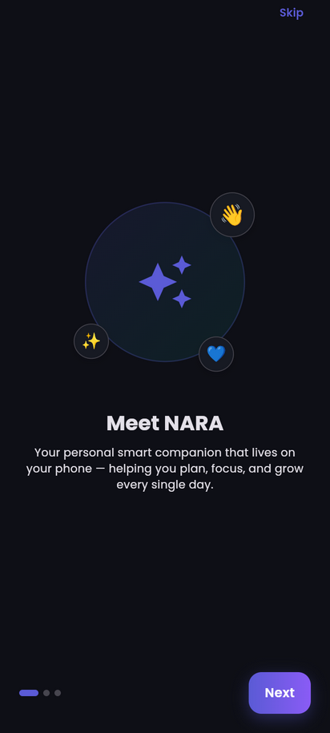
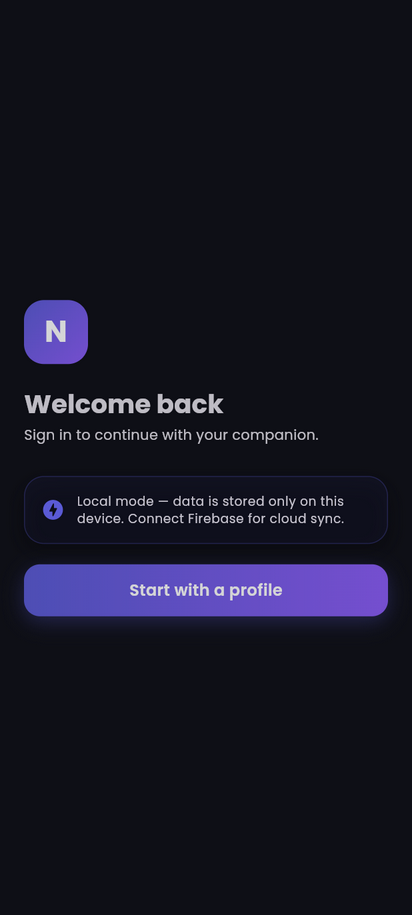
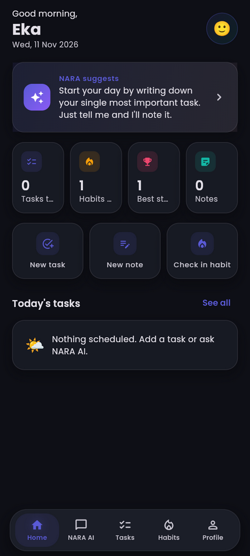
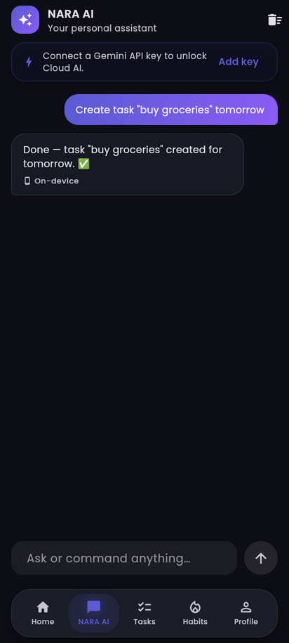
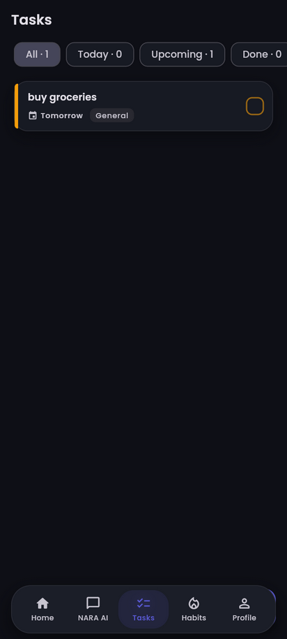
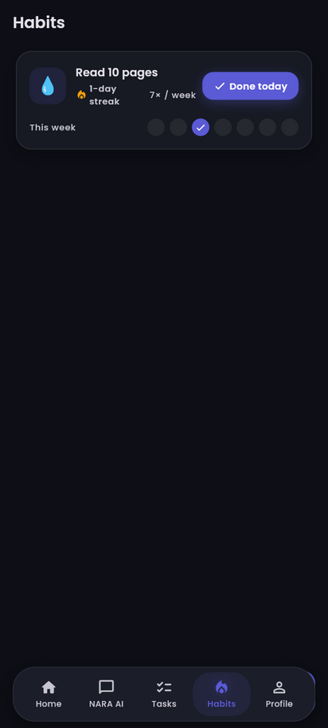
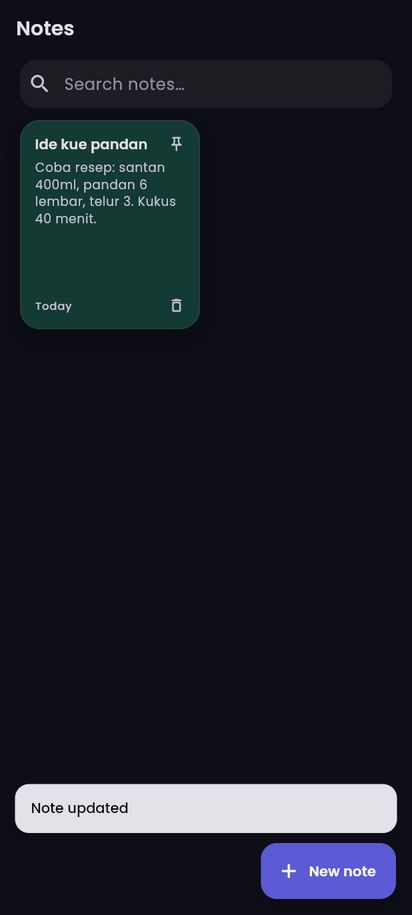
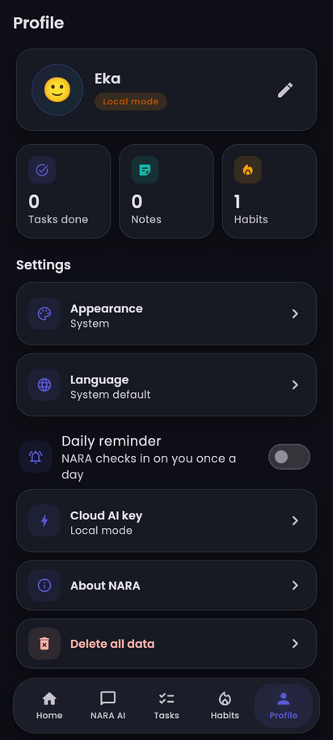

# NARA — Pendamping Pintar di Smartphonemu 🌟

**NARA** adalah aplikasi pendamping pribadi berbasis **Flutter + Firebase**: asisten AI hybrid, tugas, catatan, dan kebiasaan dalam satu aplikasi Android yang elegan dan bilingual (🇮🇩 Indonesia / 🇬🇧 Inggris).

> "Pendamping pintarmu, setiap hari." — *"Your smart companion, every day."*

## 📸 Cuplikan Layar

| Onboarding | Login | Beranda | NARA AI |
|---|---|---|---|
|  |  |  |  |

| Tugas | Kebiasaan | Catatan | Profil |
|---|---|---|---|
|  |  |  |  |

## ✨ Fitur

- 🤖 **NARA AI (hybrid)** — ngobrol & memberi perintah: *"buat tugas laporan besok jam 9"*, *"catat bahwa ide kue pandan"*, *"sudah olahraga hari ini"* — asisten benar-benar mengeksekusi. Instan & offline di perangkat; makin terbuka dengan **AI Cloud** (Gemini, key opsional).
- ✅ **Tugas** — prioritas, kategori, tenggat + jam, filter pintar, undo hapus.
- 📝 **Catatan** — grid warna, pin, pencarian, autosave.
- 🔥 **Kebiasaan** — check-in harian, streak, progress mingguan, target/minggu.
- 🏠 **Beranda pintar** — sapaan personal, saran AI kontekstual, statistik, aksi cepat.
- 🔔 **Pengingat harian** — notifikasi terjadwal.
- 🌗 **Tema gelap/terang** Material 3 + font Poppins, offline-first, dan **mode lokal** (app tetap berfungsi 100% tanpa Firebase).

## 🚀 Menjalankan Proyek

### Prasyarat
- Flutter 3.47+ / Dart 3.13+ (`flutter doctor`)
- Android SDK (API 23+)

### Mode Demo (tanpa setup apa pun)
```bash
flutter pub get
flutter run
```
Tanpa Firebase, aplikasi otomatis berjalan dalam **mode lokal**: buat profil, dan semua fitur berfungsi penuh dengan data di perangkat.

### Mode Produksi (Firebase)
1. Buat proyek di [Firebase Console](https://console.firebase.google.com) → aktifkan **Authentication → Sign-in method → Google** dan **Firestore**.
2. Untuk Google Sign-In: **Project settings → Your apps → Android → Add fingerprint** (tempel SHA-1 `keytool -list -v -keystore %USERPROFILE%\.android\debug.keystore -alias androiddebugkey -storepass android`), lalu **Download google-services.json** dan timpa ke `android/app/` (harus berisi `oauth_client` — tanpa itu Google Sign-In gagal di HP).
3. Sambungkan proyek Flutter:
   ```bash
   dart pub global activate flutterfire_cli
   flutterfire configure
   ```
   Perintah ini **menimpa** `lib/firebase_options.dart` (saat ini masih template placeholder → mode lokal) dengan kredensial proyek Anda, sehingga aplikasi otomatis beralih dari mode lokal ke Firebase.
4. Deploy security rules & indexes:
   ```bash
   firebase deploy --only firestore:rules,firestore:indexes
   ```
5. (Opsional) Aktifkan **AI Cloud**:
   ```bash
   flutter run --dart-define=NARA_GEMINI_API_KEY=KEY_ANDA \
     --dart-define=NARA_GEMINI_BASE_URL=https://host-anda/v1beta/models \
     --dart-define=NARA_GEMINI_MODEL=gemini-2.0-flash
   ```
   atau atur runtime lewat **Profil → AI Cloud key**: tempel key, pilih format **Gemini** atau **OpenAI** (OpenRouter/DeepSeek/Ollama/LM Studio dsb.), lalu isi **Base URL** & **Model** sendiri — semua tersimpan hanya di perangkat, field kosong = kembali ke default. Key Gemini gratis: [aistudio.google.com](https://aistudio.google.com).

### Build Rilis
```bash
flutter build apk --release --target-platform android-arm64,android-x64   # APK (arm64+x64)
flutter build appbundle --release    # AAB untuk Play Store
```
> Sebelum rilis: pasang keystore signing di `android/app/build.gradle.kts` (saat ini masih debug-signing agar `--release` bisa langsung dites).
> `--target-platform` dibatasi ke arm64+x64 karena Smart App Control di mesin ini memblokir `gen_snapshot` 32-bit; semua HP modern (2017+) memakai arm64.

### Perintah Kualitas
```bash
flutter analyze   # 0 temuan
flutter test      # 40+ test unit/repo/widget
```

## 🏗️ Arsitektur Ringkas

```
features/ (auth, chat, tasks, notes, habits, dashboard, profile, settings)
   └─ interface Repository ──┬─ Firebase*Repository  (produksi)
                             └─ Local*Repository     (demo/offline)
core/ (theme, router, DI, models, LocalStore, AI engine, notifications)
```

- **State**: Riverpod (`StreamProvider` untuk data, `Notifier` untuk preferensi/UI).
- **Navigasi**: go_router, bottom-nav 5 tab (stateful shell).
- **AI hybrid**: `AssistantEngine` (on-device, deterministik, bisa mengeksekusi aksi) + `GeminiService` (cloud, fallback otomatis ke lokal saat gagal).
- Dokumentasi lengkap: [`docs/BLUEPRINT.md`](docs/BLUEPRINT.md) · [`docs/DESIGN.md`](docs/DESIGN.md) · [`docs/ARCHITECTURE.md`](docs/ARCHITECTURE.md) · [`docs/DATABASE.md`](docs/DATABASE.md) · [`docs/SECURITY.md`](docs/SECURITY.md).

## 📁 Struktur

```
├── lib/                  # source (feature-first)
├── test/                 # unit + widget tests
├── assets/fonts/         # Poppins (OFL)
├── android/              # platform Android (minSdk 23)
├── firestore.rules       # security rules per-user
├── firestore.indexes.json
├── docs/                 # blueprint, desain, arsitektur, DB, security + screenshots/
└── .github/workflows/    # CI: analyze + test + build
```

## 🗺️ Roadmap
Widget home screen → pengingat per-tugas → ekspor data → proxy AI Cloud Function → iOS.

## 📄 Lisensi Aset
Kode proyek milik Anda. Font [Poppins](https://fonts.google.com/specimen/Poppins) (SIL OFL). — Dibangun dengan Flutter & Firebase.
